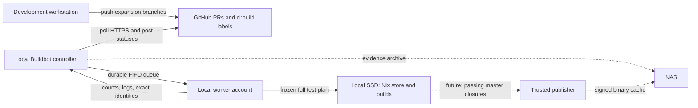

# TVP CI architecture

This describes the queue and validation process. Host configuration and deployment
state are maintained separately from the repository.

## Decisions

- GitHub hosts PRs, reviews, the `ci:build` opt-in label and the `tvp/full` status.
- A Buildbot controller on the local Linux builder polls GitHub over outbound HTTPS.
  It owns the durable queue, credentials, history and reporting.
- TVP's existing frozen-plan runner builds **the entire catalogue and its checks** for
  every admitted PR and every master update. No changed-package-only shortcut.
- Keep the active Nix store on local SSD and reuse its outputs between builds.
  No TVP binary-cache service, signing or publication in this first version.
- The NAS is the archive tier and future master binary-cache storage, not a
  network mount for the active Nix store or controller database.
- The development workstation stays independent: develop new packages and fixes there
  while the builder processes queued expansion requests.



All Internet traffic starts on the local PC. GitHub never connects to it. No router
forwarding, public DNS, webhook listener, LAN discovery service or inbound Internet
port is needed. Controller HTTP and worker protocol bind to `127.0.0.1`. An optional
reverse proxy on the host exposes the dashboard on its LAN address.

## Queue and expansion workflow

1. Open independent PRs, such as "PHP 7.3", "PHP 7.2" and "older Autoconf".
2. Add `ci:build` to each ready PR. Drafts are not scheduled.
3. The next poll admits the current full head SHA and master/base SHA. Buildbot stores
   the request in its local database and reports GitHub status **pending**.
4. One full validation runs per worker; other PRs stay queued. Within that validation,
   Nix inherits its normal machine-wide job/core settings. CI adds no Nix resource caps.
5. Read the failing version and test, fix the PR and push. Keeping `ci:build` attached
   automatically schedules its new head; no repeated labelling is needed.
6. Merge a passing PR. Master receives its own full validation. Other labelled PRs
   are also revalidated when their base changes, even if their head stays the same.

Requests contain immutable SHAs, never a moving branch name. The worker merges the
pinned base into the pinned head before evaluating the catalogue, so passing means
that integration was tested. A merge conflict is a failed validation requiring an
update to the PR. Evidence records head, base, resulting merge and frozen source/plan.
Two passing sibling PRs are not a guarantee that their later combination passes.

The first queue preserves requests rather than silently collapsing different commits.
A push does not stop an older running build. Multiple revisions can be queued for one
PR; each reports only against its own head. Rebuilding the exact same request is
available through the authenticated Buildbot Rebuild action. Removing the label stops
future admissions; already queued/running requests remain until an operator cancels
or they finish. Closing a PR has the same admission-only effect.

The poller paginates all open PRs, compares complete SHAs and persists delivery state
only after Buildbot accepts a change. Restarting does not forget previously admitted
identities. A crash between delivery and recording may produce a duplicate request;
it must not lose a build. The queue database and controller state stay on local disk.

## What a full validation does

The controller sends a reviewed worker harness and graph comparator. The harness
selects the test-runner executable from the controller's pinned TVP revision, rather
than executing the PR's copy of the CI runner. All candidate evaluation and builds
happen under the worker account.

For PRs:

1. Fetch exact head and base commits into separate work directories.
2. Form their integration tree and record its identity.
3. Evaluate base and candidate producer graphs. New packages pass the graph policy;
   removed or unexpectedly changed producers fail. A PR cannot approve its own changes
   to existing derivations or weaken the comparator used by CI.
4. Run `nix flake check --no-build` on the candidate.
5. Start its full frozen test plan through the trusted test runner, wait using the
   returned exact run identity and require both exit success and terminal `passed`.
6. Collect final suite/test counts, frozen plan, Nix logs and available full failure
   logs. Upload evidence to the controller even on failure.

Master follows the same full validation without a PR graph comparison. Its commit is
already exact and reviewed. The per-build checkout/state directory prevents two PRs
from sharing a mutable source tree. Successful store outputs and test outputs can be
reused across requests when their derivations match. "Full suite" means all declared
outputs are realised; it does not force unchanged cached tests to execute again.

Intentional changes to existing producers require a controller-owned `graph_approvals`
entry keyed by `PR_NUMBER:HEAD_SHA:BASE_SHA`, listing exact producer names. The
comparator rejects stale/unused allowances and removals. Any new head or base requires
review again. Routine additions need no approval entry. A broad base retirement or
change to removal policy is a separate controller policy review, not an expansion PR.

## GitHub and local communication

GitHub's `tvp/full` commit status shows queued, running, success or failure. Terminal
descriptions include suite/test totals and failing suite names, within GitHub's status
length limit. This uses the Commit Status API; a GitHub Actions runner or public
webhook endpoint is not involved.

The status details link points at the local Buildbot UI. Its queue, steps and full
failure logs are available at `http://localhost:8010/` on the builder. That address is
not reachable from another computer unless access is configured. For LAN access, use
a host-managed reverse proxy and set the private `dashboard_url` accordingly. An SSH
tunnel is another option:

```sh
ssh -N -L 8010:127.0.0.1:8010 user@builder
```

SSH is optional for installation; the initial setup can be performed at the PC's
console. No SSH address is needed in CI configuration. Without a tunnel or other
explicit private access, GitHub still shows the short status; it does not host the
complete logs. Controller evidence can later be archived to the NAS for private access.
A GitHub App with Check Run summaries is a possible later reporting improvement.

There are no automatic PR comments. The controller never receives instructions from
PR titles, bodies or comments. The reviewed controller checkout is updated separately
from the PRs it builds.

## Initial trust boundary

The initial pool admits labelled, non-draft PRs whose head and base repositories are
both `trayanr/tvp`, targeting master. It is for maintainer-controlled expansion branches.
Fork PRs are not admitted to this pool, even when labelled. This is deliberate scope:
[Nix evaluation and builds execute candidate-controlled instructions](https://docs.github.com/en/actions/reference/security/secure-use#hardening-for-self-hosted-runners).

Controller and worker run as separate Unix users. The worker is a regular, untrusted
Nix-daemon client, with sandboxing enabled; it does not receive the GitHub token,
operator password, signing keys or NAS write credentials. Worker authentication is a
separate secret. The worker is not added to Nix's `trusted-users`.

Before accepting untrusted contributors, add disposable VM workers with no home-LAN
access and no controller/publisher credentials. Each VM has a private writable Nix
store. Verified master outputs may be supplied read-only; writable stores and outputs
from untrusted VMs are never automatically promoted into a trusted master's store or
cache. A new directory or Nix build sandbox alone is not that VM boundary.

Buildbot and its Python dependencies are CI infrastructure from the repository's
pinned Nixpkgs input, not newly added canonical TVP packages.

## Storage and future master caching

| Data | Initial home | Longer-term role |
| --- | --- | --- |
| Build scratch, checkouts, active `/nix` | Builder local SSD | Fast working data and reuse |
| Queue database and controller state | Builder local SSD | Durable local scheduling; backup to NAS |
| Run identities, plans and failure logs | Controller storage, optionally NAS-backed | Indexed by commit and build number |
| Upstream source archives | Existing source fetchers | Optional independent NAS mirror |
| Passing master output closures | Rooted local Nix store | Signed binary cache backed by NAS |
| PR build outputs | Local trusted-worker store | Working results, not published master artifacts |

Retain the existing runner's GC roots while results are needed. Do not garbage-collect
those roots merely because a Buildbot step finished: they protect reuse and debugging.
An explicit retention policy will distinguish active PRs, failed evidence and passing
master releases. No automatic deletion or NAS migration is introduced by this change.

Later add a **separate trusted publisher** after master succeeds. It consumes that
exact run's output closures, signs them and copies them into a NAS-backed binary cache.
The NAS can store NARs and metadata as a directory cache or object storage, served
read-only to clients over HTTP(S). [Nix supports file-based binary caches](https://nix.dev/manual/nix/2.35/command-ref/new-cli/nix3-help-stores.html).
Signing credentials stay with the publisher. Keep the master cache/archive independently
of the builder's working-store GC and avoid promoting PR-only outputs.

A shared NAS mount of the active `/nix` database is not part of this design. The
controller also uses SQLite on local disk; [SQLite's network-filesystem limitations](https://www.sqlite.org/useovernet.html)
are another reason to archive/backup state rather than share a live database.
NAS capacity alone does not establish its I/O performance: inspect disks, SSD tier,
filesystem and link speed before selecting its eventual cache-serving arrangement.

## Repository and host configuration

`ci/buildbot/` contains the queue, validation harness, reporting and their tests.
Service units and example settings describe how to deploy it. Importing the TVP flake
or building a package does not load Buildbot or install services.

Actual controller settings, credentials, proxy configuration, NAS mounts and host setup
scripts stay outside the repository. Deploy a reviewed CI revision independently of
the PRs it builds.

See [the operator handoff](README.md) for preparation and local checks.
