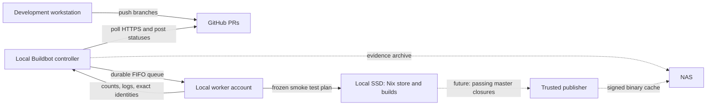

# TVP CI architecture

This describes the queue and validation process. Host configuration and deployment
state are maintained separately from the repository.

## Decisions

- GitHub hosts PRs, reviews and the `tvp/smoke` status. Repository PRs are scheduled
  automatically, including drafts and stacked branches.
- A Buildbot controller on the local Linux builder polls GitHub over outbound HTTPS.
  It runs as the administrator's systemd user service and owns the durable queue,
  credentials, history and reporting. A separate worker Unix account executes builds.
- TVP's existing frozen-plan runner builds the explicitly declared small smoke
  selection for admitted PRs and master updates. Full catalogue and upstream suites
  are separate explicit requests; a smoke pass never certifies them.
- Keep the active Nix store on local SSD and reuse its outputs between builds.
  The private deployment's existing cache operator publishes frozen workstation
  outputs to a signed NAS-backed work cache consumed by the worker. Signing and
  publication are managed separately from the CI controller.
- The NAS holds archives and the private work cache. The active Nix store and
  controller database stay on local disk. Public master-cache activation is a
  separate later phase.
- The development workstation stays independent: develop new packages and fixes there
  while the builder processes queued expansion requests.



All Internet traffic starts on the local PC. GitHub never connects to it. No router
forwarding, public DNS, webhook listener, LAN discovery service or inbound Internet
port is needed. Controller HTTP and worker protocol bind to `127.0.0.1`. An optional
reverse proxy on the host exposes the dashboard on its LAN address.

## Queue and expansion workflow

1. Open independent PRs, such as "PHP 7.3", "PHP 7.2" and "older Autoconf".
2. Open PRs are scheduled automatically; no label or ready-for-review transition
   is required. Both their head and target must belong to this repository.
3. The next poll resolves the actual target ref, independently of the PR payload's
   possibly stale base SHA, and compares that immutable tip with the full head SHA.
   Only an ahead or identical head is admitted. Behind/diverged branches get a pending
   `tvp/smoke` instruction to rebase or merge the target, without a build request.
   Buildbot stores admitted requests in its database and reports **pending**.
4. One smoke validation runs per worker; other PRs stay queued. Within that validation,
   Nix inherits its normal machine-wide job/core settings. CI adds no Nix resource caps.
5. Read the failing version and test, fix the PR and push. The next poll
   automatically schedules its new head.
6. Squash merge a passing PR, with `tvp/smoke` required and GitHub's up-to-date branch
   requirement enabled. Squash-only merging and linear history are enforced on
   master, including for administrators. Master receives its own smoke validation. Update other
   branches to include the new target and wait for their updated heads to pass.

Requests contain immutable head and target SHAs. Before any Nix evaluation or builds,
the worker fetches the PR's admitted target branch (master for master/manual requests), requires its tip to
equal the queued base and verifies that it is an ancestor of the head. An advance after
admission requires a branch update and requeue. CI never edits the candidate branch or
constructs a synthetic merge. Evidence records head, base and frozen source/plan;
the compatibility field `identity.merge` equals the exact head.
Two passing sibling PRs are not a guarantee that their later combination passes.

When a new automatic request is admitted, Buildbot marks older unclaimed automatic
requests for the same PR and target branch as skipped if their head or pinned base
differs. Claimed, manual, rebuild, and master requests keep their own lifecycle.
Each run reports against its exact head. The authenticated Buildbot Rebuild action
can replay an exact request. Closing a PR stops future admissions.

The poller paginates all open PRs and resolves each eligible target branch once per
poll, even when the PR payload base stays unchanged. No eligible PR means no target
lookup. It persists complete admitted identities after Buildbot accepts a change,
and blocked identities after successful status reporting. Restarts do not repeat
successful deliveries or blocked reports; failed HTTP lookups or writes are retried.
A crash between delivery and recording may produce a duplicate request or status;
it must not lose a build. The queue database and controller state stay on local disk.

## What smoke validation does

The controller sends a reviewed worker harness and graph comparator. The harness
selects the test-runner executable from the controller's pinned TVP revision, rather
than executing the PR's copy of the CI runner. All candidate evaluation and builds
happen under the worker account.

For PRs:

1. Fetch exact head and base commits into separate work directories.
2. Recheck the current target and ancestry; record the unchanged head's identity.
3. Evaluate the immutable target producer graph. Four Nix client processes
   evaluate the candidate's smoke plan in parts, with the first process also
   evaluating the exact-head graph. Join and root the plan. Older candidates
   evaluate the candidate graph and plan together in one process. Record
   before/after producer identities in `graph-diff.json` for review.
4. Run `nix flake check --no-build` on the candidate in one evaluator.
5. Run `test all --smoke` through the trusted tools revision using the rooted
   plan. Require both exit success and terminal `passed`, retaining the run
   identity and its machine-readable receipt.
6. Collect final suite/test counts, frozen plan, Nix logs and available full failure
   logs. Upload evidence to the controller even on failure.

Master follows the same smoke validation without a PR graph comparison. Its commit is
already exact and reviewed. The per-build checkout/state directory prevents two PRs
from sharing a mutable source tree. Successful store outputs and test outputs can be
reused across requests when their derivations match. A smoke pass means the selected named outputs are valid. It does not certify the
omitted suites or force unchanged cached checks to execute again. Full suites
remain a separate explicit `test start --full` operation.

The graph comparison records what merging the PR would change relative to its pinned
target master, rather than changes already present since the original branch point.
Dependency selectors may advance when a release is added; affected consumers then have
new producer paths. Review those differences and the scoped smoke results together.
The report does not infer whether a change is compatible or intentional. There is no
controller-owned allowance gate for changed or removed producers. Invalid snapshots,
evaluation errors, stale/diverged branches and failed validation still fail the build.

## GitHub and local communication

GitHub's `tvp/smoke` commit status shows queued, running, success or failure. Terminal
descriptions include suite/test totals and failing suite names, within GitHub's status
length limit. This uses the Commit Status API; a GitHub Actions runner or public
webhook endpoint is not involved.

The status details link points at the local Buildbot UI. Its queue, steps and full
failure logs are available at `http://localhost:8010/` on the builder. That address is
not reachable from another computer unless access is configured. For LAN access, use
a host-managed reverse proxy and set the private `dashboard_url` accordingly. An SSH
tunnel is another option:

```sh
ssh -N -L 8010:127.0.0.1:8010 user@builder
```

SSH is optional for installation; the initial setup can be performed at the PC's
console. No SSH address is needed in CI configuration. Without a tunnel or other
explicit private access, GitHub still shows the short status; it does not host the
complete logs. Controller evidence can later be archived to the NAS for private access.
A GitHub App with Check Run summaries is a possible later reporting improvement.

There are no automatic PR comments. The controller never receives instructions from
PR titles, bodies or comments. The reviewed controller checkout is updated separately
from the PRs it builds.

## Initial trust boundary

The pool admits every open PR whose head and base repositories are both
`trayanr/tvp`, including drafts and stacked branches. It is for repository-controlled
branches. Fork PRs are not admitted to this pool. This is deliberate scope:
[Nix evaluation and builds execute candidate-controlled instructions](https://docs.github.com/en/actions/reference/security/secure-use#hardening-for-self-hosted-runners).

Controller and worker run as separate Unix users. The controller runs as `server`,
with private state in `~/.local/state/tvp-ci/controller` (mode `0700`). The worker
remains a system service under `tvp-worker`, with its existing private state in
`/var/lib/tvp-worker`. The worker is a regular, untrusted
Nix-daemon client, with sandboxing enabled; it does not receive the GitHub token,
operator password, signing keys or NAS write credentials. Worker authentication is a
separate secret. The worker is not added to Nix's `trusted-users`.

Before accepting untrusted contributors, add disposable VM workers with no home-LAN
access and no controller/publisher credentials. Each VM has a private writable Nix
store. Verified master outputs may be supplied read-only; writable stores and outputs
from untrusted VMs are never automatically promoted into a trusted master's store or
cache. A new directory or Nix build sandbox alone is not that VM boundary.

Buildbot and its Python dependencies are CI infrastructure from the repository's
pinned Nixpkgs input, not newly added canonical TVP packages.

## Storage and future master caching

| Data | Initial home | Longer-term role |
| --- | --- | --- |
| Build scratch, checkouts, active `/nix` | Builder local SSD | Fast working data and reuse |
| Queue database and controller state | Builder local SSD | Durable local scheduling; backup to NAS |
| Run identities, plans and failure logs | Controller storage, optionally NAS-backed | Indexed by commit and build number |
| Upstream source archives | Existing source fetchers | Optional independent NAS mirror |
| Passing master output closures | Rooted local Nix store | Signed binary cache backed by NAS |
| PR build outputs | Local trusted-worker store | Working results, not published master artifacts |

Retain the existing runner's GC roots while results are needed. Do not garbage-collect
those roots merely because a Buildbot step finished: they protect reuse and debugging.
An explicit retention policy will distinguish active PRs, failed evidence and passing
master releases. No automatic deletion or NAS migration is introduced by this change.

Later add a **separate trusted publisher** after master succeeds. It consumes that
exact run's output closures, signs them and copies them into a NAS-backed binary cache.
The NAS can store NARs and metadata as a directory cache or object storage, served
read-only to clients over HTTP(S). [Nix supports file-based binary caches](https://nix.dev/manual/nix/2.35/command-ref/new-cli/nix3-help-stores.html).
Signing credentials stay with the publisher. Keep the master cache/archive independently
of the builder's working-store GC and avoid promoting PR-only outputs.

A shared NAS mount of the active `/nix` database is not part of this design. The
controller also uses SQLite on local disk; [SQLite's network-filesystem limitations](https://www.sqlite.org/useovernet.html)
are another reason to archive/backup state rather than share a live database.
NAS capacity alone does not establish its I/O performance: inspect disks, SSD tier,
filesystem and link speed before selecting its eventual cache-serving arrangement.

## Repository and host configuration

`ci/buildbot/` contains the queue, validation harness, reporting and their tests.
Service units and example settings describe how to deploy it. Importing the TVP flake
or building a package does not load Buildbot or install services.

Actual controller settings, credentials, proxy configuration, NAS mounts and host setup
scripts stay outside the repository. Deploy a reviewed CI revision independently of
the PRs it builds.

The administrator owns `/srv/tvp-ci/releases` and promotes unchanged reviewed source
copies through `/srv/tvp-ci/current`. Both services read this source; only the
administrator can update it. Candidate PR checkouts never become the active source.
Controller configuration, GitHub credentials and the operator password remain in the
administrator's private controller directory, outside the shared source tree.

Root performs the one-time bootstrap: create the isolated worker account and system
unit, enable the administrator's user-manager linger for startup without a login,
and install the narrow worker sudoers rule. Normal controller operations use
`systemctl --user`; the rule permits `server` to run four exact passwordless
`/usr/bin/systemctl` commands for `tvp-worker.service`. The operator CLI invokes
worker restarts with `sudo -n`, without a credential prompt. Unit definitions and authorization
remain root-owned. The worker reconnects independently, without depending on the old
system controller unit.

Moving an existing controller preserves its complete database, history, poller state
and evidence before retiring the old system unit. Worker state and Nix GC roots stay
in place. Host Nix/cache settings, publisher state and NAS data are retained; the
worker continues consuming the configured signed HTTP cache without NAS write access.

See [the operator handoff](README.md) for preparation and local checks.
